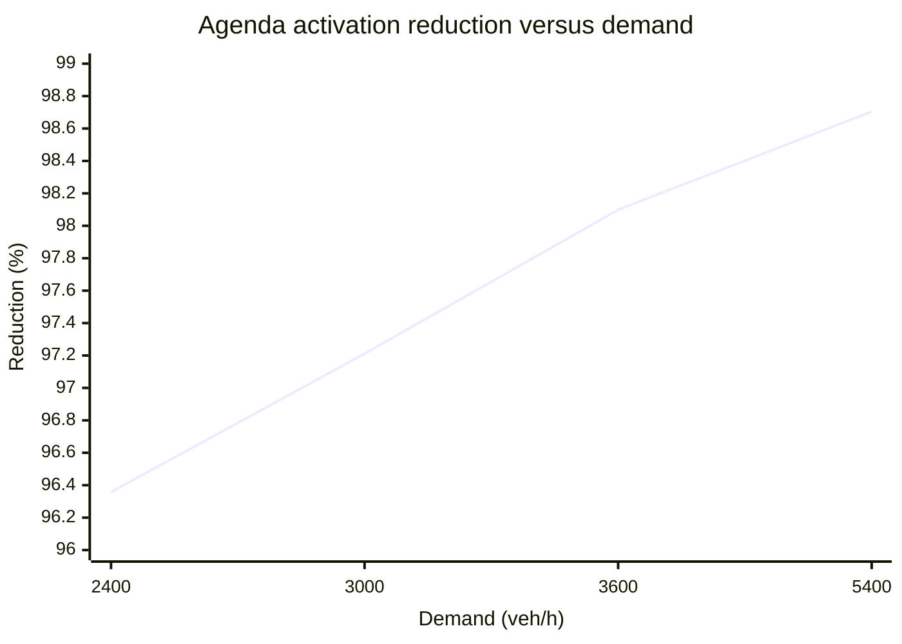

# Micro-to-Meso Validation Log

Companion record for [final_micro_to_meso_blueprint.md](final_micro_to_meso_blueprint.md).

This is the single durable record for micro-to-meso validation runs, derived
comparisons, gate decisions, and remaining work.  It records meaningful run
results rather than complete IDE launch commands or cleanup output.

**Current status (2026-09-16): Gates 1 and 2 are CLOSED.** Gate 1 experiments
A (finite-storage admission/wakeup) and B (held-out capacity/fidelity) passed.
Gate 2's mixed-resolution behavioral checks also passed; see the Gate 2 results
below. Do not reopen either gate or begin a new city-scale network framework
from this document.

MicroIR and MesoSpec v0.1 now have typed representations, validation, JSON
parsing/schema support, and canonical JSON identities. The ScalaTion MesoSpec
translator has passed one-link, three-link linear, and branching/merging runs;
these runs are meso-only, not generated mixed-resolution runs.

One specification gap remains before extending that translator: `MesoLink`
currently specifies free-flow time, capacity, and storage, but not an
IDM-derived density-sensitive speed relation. `MesoVTransport` accepts
`IdmFlux`, but the current MesoSpec translators do not supply one. Decide how
the relation and its source IDM parameters are represented before coding that
extension.

## Remaining work

1. Decide and record the IDM-flux semantics in MesoSpec, reusing the source
   MicroIR parameters without creating a second conflicting authority.
2. Extend `T_S` from meso-only networks to a generated mixed micro/meso model.
3. Implement `T_M` from the same MesoSpec.
4. Check bounded ScalaTion/Maude trace agreement.
5. Freeze and run the mutation study, then evaluate LLM generation against the
   deterministic baseline.

The blueprint has the same status and ordered work list; city-scale builder
expansion is outside this paper's current scope.

## Measurement definitions

- **Whole-run throughput** = completed vehicles x 3600 / simulation duration.
- **Agenda activations** = actors dequeued by the shared `Model` scheduler during
  the simulation scheduling loop.  This includes source and vehicle work; it is
  deliberately not called movement activations.
- **Activations per completed vehicle** = agenda activations / sink completions.
- **Activation reduction** = 1 - meso agenda activations / micro agenda activations.
- **Corrected saturated capacity estimate** =
  `(nStop - 1) x 3600 / (simulation duration - first free-flow completion time)`.
- Whole-run throughput is not itself saturated discharge capacity because it
  includes initial free-flow traversal and final drainage.

## Gate 1 - Single-Link Validation

### G1.1 Deterministic mesoscopic correctness

Configuration and results:

| Measure | Expected | Observed |
|---|---:|---:|
| Entered vehicles | 30 | 30 |
| Released vehicles | 30 | 30 |
| Completed vehicles | 30 | 30 |
| Final occupancy | 0 | 0 |
| Free-flow time | 50.0 s | 50.0 s |
| Release headway | 2.0 s | 2.0 s |
| First release | 50.0 s | 50.0 s |
| Last release | 108.0 s | 108.0 s |

**Decision: PASS.** FIFO release timing, completion accounting, and final
occupancy matched their exact expected values.

### G1.2 Low-demand micro-to-meso comparison

Configuration:

| Parameter | Value |
|---|---:|
| Arrival rate (`lambda`) | 10 veh/h |
| Vehicles (`nStop`) | 30 |
| Intermediate junctions | 0 |
| Transport segments | 1 |
| Lanes | 1 |
| Segment length | 1400 m |
| Nominal free-flow speed | 68 mph = 108.948 km/h |

Results:

| Measure | Micro | Meso |
|---|---:|---:|
| Generated vehicles | 30 | 30 |
| Completed vehicles | 30 | 30 |
| Mean travel time | 49.183333 s | 46.260529 s |
| Simulation duration | 11380.003259 s | 11388.763788 s |
| Whole-run throughput | 9.490331 veh/h | 9.483031 veh/h |
| Mean traversal speed | 102.474 km/h | 108.948 km/h |
| Whole-run mean density | 0.093 veh/km/lane | 0.087 veh/km/lane |
| Agenda activations | 3011 | 90 |
| Activations/completed vehicle | 100.366667 | 3.000000 |

Derived comparison:

- Meso mean travel time is 5.94% below micro.
- Whole-run throughput differs by approximately 0.08%.
- Meso reduces agenda activations by 97.01%.
- Micro uses 33.46 times as many agenda activations as meso.

**Decision: PASS.** Both models complete the same low-demand workload with
nearly identical throughput.  The travel-time difference is consistent with
discrete IDM/Ballistic micro movement versus fixed mesoscopic free-flow
traversal.  The activation result confirms the intended sparse mesoscopic
execution.

### G1.3 Offered demand above configured mesoscopic capacity

Configuration:

| Parameter | Value |
|---|---:|
| Arrival rate (`lambda`) | 2400 veh/h |
| Mean arrival headway | 1.5 s |
| Vehicles (`nStop`) | 300 |
| Intermediate junctions | 0 |
| Transport segments | 1 |
| Lanes | 1 |
| Segment length | 1400 m |
| Configured meso capacity | 1800 veh/h |
| Meso release headway | 2.0 s |

Recorded mesoscopic results:

| Measure | Value |
|---|---:|
| Generated vehicles | 300 |
| Completed vehicles | 300 |
| Mean travel time | 128.839212 s |
| Simulation duration | 644.260529 s |
| Whole-run throughput | 1676.340472 veh/h |
| Agenda activations | 1496 |
| Activations/completed vehicle | 4.986667 |

The mesoscopic duration agrees with `46.260529 + 299 x 2.0 = 644.260529`
seconds.  This is evidence that the link remained continuously constrained
after its first release and enforced its configured two-second discharge
headway.

Recorded micro findings from the matched run:no

| Measure | Value |
|---|---:|
| Generated vehicles | 300 |
| Completed vehicles | 300 |
| Mean travel time | 67.463333 s |
| Simulation duration | 499.496956 s |
| Whole-run throughput | 2162.175341 veh/h |
| Mean traversal speed | 74.707 km/h |
| Whole-run mean density | 28.942 veh/km/lane |
| Agenda activations | 41078 |
| Activations/completed vehicle | 136.926667 |

The micro run discharged faster than the mesoscopic link configured at 1800
veh/h.  Therefore this run establishes that 1800 veh/h is not the matching
micro capacity.  The exact micro capacity must be measured before saturated
micro-to-meso fidelity can be judged.

**Mesoscopic capacity enforcement: PASS.**

**Historical pre-calibration result: superseded.** The subsequent calibration
and held-out run below are the authoritative Gate 1 results.

Matched results after raising offered demand to 3600 veh/h while retaining
`nStop = 300`:

| Measure | Micro | Meso |
|---|---:|---:|
| Generated vehicles | 300 | 300 |
| Completed vehicles | 300 | 300 |
| Mean arrival interval | 1.0 s | 1.0 s |
| Mean travel time | 130.253333 s | 200.979651 s |
| Simulation duration | 523.664637 s | 644.260529 s |
| Whole-run throughput | 2062.388643 veh/h | 1676.340472 veh/h |
| Mean traversal speed | 38.694 km/h | 25.077 km/h |
| Whole-run mean density | 53.300 veh/km/lane | 66.847 veh/km/lane |

| Agenda activations | 78752 | 1497 |
| Activations/completed vehicle | 262.506667 | 4.990000 |

At this demand, meso reduces agenda activations by 98.10%; micro uses 52.61
times as many activations.  The mesoscopic last-completion time remains fixed
by its configured 1800 veh/h discharge capacity, while its mean travel time
rises because vehicles arrive earlier and wait longer.

Matched results at 4800 veh/h offered demand and `nStop = 300`:

| Measure | Micro | Meso |
|---|---:|---:|
| Generated vehicles | 300 | 300 |
| Completed vehicles | 300 | 300 |
| Mean arrival interval | 0.75 s | 0.75 s |
| Mean travel time | 182.328333 s | 237.049871 s |
| Simulation duration | 551.498478 s | 644.260529 s |
| Whole-run throughput | 1958.300963 veh/h | 1676.340472 veh/h |
| Mean traversal speed | 27.642 km/h | 21.261 km/h |
| Whole-run mean density | 70.844 veh/km/lane | 78.845 veh/km/lane |
| Agenda activations | 109997 | 1497 |
| Activations/completed vehicle | 366.656667 | 4.990000 |

Meso reduces agenda activations by 98.64% at this demand; micro uses 73.48
times as many activations.  The mesoscopic run was repeated and produced the
same reported values, confirming reproducibility for the same parameters and
random-number stream.

### G1.4 Micro effective-capacity sweep

Keep `nStop = 300` and run the micro model at successively higher offered
demand.  The micro capacity is identified when two successive corrected
capacity estimates differ by no more than 1-2% while mean travel time continues
to rise.

Use the measured micro free-flow completion time of `49.183333 s` in:

`corrected capacity = 299 x 3600 / (simulation duration - 49.183333)`

| Lambda (veh/h) | nStop | Duration (s) | Whole-run throughput (veh/h) | Corrected capacity (veh/h) | Mean travel time (s) | Agenda activations | Activations/vehicle | Interpretation |
|---:|---:|---:|---:|---:|---:|---:|---:|---|
| 2400 | 300 | 499.496956 | 2162.175341 | 2390.334085 | 67.463333 | 41078 | 136.926667 | Demand-limited/lower-congestion estimate |
| 3000 | 300 | 481.597564 | 2242.536258 | 2489.279775 | 88.343333 | 53606 | 178.686667 | Held-out observation; highest corrected discharge observed, not used to fit C |
| 3600 | 300 | 523.664637 | 2062.388643 | 2268.582538 | 130.253333 | 78752 | 262.506667 | Saturated; estimate is 5.09% below 2400 run |
| 4800 | 300 | 551.498478 | 1958.300963 | 2142.877857 | 182.328333 | 109997 | 366.656667 | Saturated; estimate is 5.54% below 3600 run |

The expanded sweep does not exhibit a constant-capacity plateau.  The 2400
veh/h case remained partly demand-limited, while the held-out 3000 veh/h case
produced the highest observed corrected discharge estimate, 2489.280 veh/h.
At higher demands, corrected discharge decreases as forced entry density
intensifies IDM congestion.

This demonstrates that effective microscopic discharge is regime-dependent,
whereas the present mesoscopic baseline deliberately uses one fixed capacity.
Because 3000 veh/h was designated as held-out demand, its result was not used
to revise the frozen value `C = 2390 veh/h`.  This preserves the out-of-sample
evaluation protocol.

### G1.5 In-sample consistency after mesoscopic capacity calibration

The mesoscopic capacity was set to `2390 veh/h`, the rounded maximum corrected
micro flow observed in the 2400 and 3600 veh/h fit set.  Offered demand was
returned to `lambda = 3600 veh/h` with `nStop = 300`.  The mesoscopic result is
compared against the already-recorded micro run at the same fit demand.

| Measure | Micro | Calibrated meso | Meso relative to micro |
|---|---:|---:|---:|
| Generated vehicles | 300 | 300 | 0.00% |
| Completed vehicles | 300 | 300 | 0.00% |
| Mean arrival interval | 1.0 s | 1.0 s | 0.00% |
| Mean travel time | 130.253333 s | 127.167936 s | -2.37% |
| Simulation duration | 523.664637 s | 496.637098 s | -5.16% |
| Whole-run throughput | 2062.388643 veh/h | 2174.626107 veh/h | +5.44% |
| Mean traversal speed | 38.694 km/h | 39.633 km/h | +2.43% |
| Whole-run mean density | 53.300 veh/km/lane | 54.870 veh/km/lane | +2.95% |
| Agenda activations | 78752 | 1497 | -98.10% |
| Activations/completed vehicle | 262.506667 | 4.990000 | -98.10% |

Micro uses 52.61 times as many agenda activations as calibrated meso.  All 300
vehicles complete in both models.  The macroscopic measures remain within
approximately 5.5%, while mean travel time, speed, and density remain within
3%.

**Working single-capacity calibration: PASS at 2390 veh/h.**  This parameter
matches the maximum observed micro flow for the present one-link experiment;
it does not claim that IDM has a demand-independent discharge rate under every
congestion level.

**In-sample calibrated consistency: PASS.**

This comparison confirms that the fixed-capacity mesoscopic implementation can
reproduce the calibration regime closely.  Out-of-sample behavior is evaluated
separately in Experiment B.

### G1.6 Experiment A - Finite-storage admission/wakeup mechanism

This is a deterministic correctness test, not a micro-to-meso fidelity test.
It validates finite admission, FIFO blocking, one-for-one space release, and
event-driven wakeup without polling.

Configuration:

| Parameter | Value |
|---|---:|
| Vehicles | 4 |
| Arrival interval | 0.5 s, deterministic |
| Link length | 500 m |
| Free-flow speed | 68 mph = 30.263 m/s |
| Free-flow traversal | 50.0 s |
| Discharge capacity | 1800 veh/h |
| Release headway | 2.0 s |
| Storage capacity | 2 vehicles |

Expected trace derived before execution:

| Time (s) | Expected event | Occupancy after event |
|---:|---|---:|
| 0.0 | V1 admitted | 1 |
| 0.5 | V2 admitted | 2 |
| 1.0 | V3 blocked outside the link | 2 |
| 1.5 | V4 blocked behind V3 | 2 |
| 50.0 | V1 releases; its freed slot is reserved for and wakes V3 | 1, then 2 after V3 admission |
| 52.0 | V2 releases; its freed slot is reserved for and wakes V4 | 1, then 2 after V4 admission |
| 100.0 | V3 releases | 1 |
| 102.0 | V4 releases | 0 |

Expected total agenda activations: `15` (`4` source activations plus `11`
vehicle activations).  A blocked vehicle receives exactly one storage wakeup;
its later free-flow completion is normal traversal work, not polling.

Acceptance checks:

- maximum occupancy is at most 2;
- V3 receives `SPACE_RELEASE` before V4;
- no blocked vehicle polls;
- entered = released = completed = 4;
- final admitted occupancy and blocked queue are both zero.

Observed trace matched the hand-derived trace exactly:

- V1 and V2 were admitted at 0.0 and 0.5 s;
- V3 and V4 blocked at 1.0 and 1.5 s;
- V3 received `SPACE_RELEASE` and woke at 50.0 s before V4 at 52.0 s;
- releases occurred at 50.0, 52.0, 100.0, and 102.0 s;
- maximum occupancy was 2 and final occupancy was 0;
- entered = released = completed = 4; and
- agenda activations were exactly 15, confirming that blocked vehicles did not poll.

**Status: PASS.**

This one-link experiment proves the admission/wakeup mechanism.  It does not
alone prove physical spillback across connected links, because the current
vehicle script leaves one segment before attempting admission to the next.
Cross-link transfer ownership is a Gate 2 boundary concern.

### G1.7 Experiment B - Frozen held-out fidelity

Experiment B tests whether one fixed mesoscopic capacity and storage limit,
chosen without seeing the test cases, continue to track the microscopic model
as congestion rises.  It is a fidelity and abstraction-limit test, not another
correctness test.

The fit demands are 2400 and 3600 veh/h.  The fit-side corrected micro discharge
was 2390.334 veh/h at 2400 demand and 2268.583 veh/h at 3600 demand.  Since the
simple meso accepts only one fixed capacity, the declared fitting rule is to use
the maximum observed fit-side discharge, rounded to a whole vehicle per hour:
`C = 2390 veh/h`.  The lower 3600 result documents the IDM capacity drop that a
fixed `C` cannot reproduce; it is not averaged into a demand-specific parameter.
Rerun micro at 3600 veh/h and read maximum occupancy from the segment's native
`TimeStatistic.max`.  For the one-lane 1.4-km link:

`K = floor(rho_max * 1.4 km * 1 lane) = maximum observed occupancy`

Record `C`, `K`, and the freeze date here before any held-out result is viewed.
Then do not retune either parameter.

The 3600 veh/h micro fit run completed all 300 vehicles and reported maximum
occupancy 133 and maximum instantaneous density 95.000 veh/km/lane.  Therefore:

`K = floor(95.000 * 1.4 * 1) = 133 vehicles`

After freezing, run micro and meso with the same arrival-stream configuration,
`nStop = 300`, at the held-out demands of 3000 and 5400 veh/h.  Record mean
travel time, mean traversal speed, mean density, whole-run throughput,
simulation duration, agenda activations, and activations per completed vehicle.
Report meso relative to micro for each measure.  A poor 5400 veh/h result is a
valid finding and must not cause post-test fitting.

Frozen configuration:

| Parameter | Value |
|---|---|
| C | 2390 veh/h |
| K | 133 vehicles |
| Freeze date | 2026-09-09 |

Held-out comparison table:

| Demand | Model | Mean travel time | Mean traversal speed | Mean density | Whole-run throughput | Duration | Agenda activations | Activations/completed vehicle |
|---:|---|---:|---:|---:|---:|---:|---:|---:|
| 3000 | Micro | 88.343 s | 57.050 km/h | 39.308 veh/km/lane | 2242.536 veh/h | 481.598 s | 53606 | 178.687 |
| 3000 | Meso | 98.312 s | 51.265 km/h | 42.419 veh/km/lane | 2174.626 veh/h | 496.637 s | 1495 | 4.983 |
| 5400 | Micro | 207.195 s | 24.325 km/h | 77.855 veh/km/lane | 1893.818 veh/h | 570.276 s | 124917 | 416.390 |
| 5400 | Meso | 175.262 s | 28.757 km/h | 75.621 veh/km/lane | 2174.626 veh/h | 496.637 s | 1619 | 5.397 |

Meso relative to micro (`100 * (meso - micro) / micro`):

| Demand | Travel time | Speed | Density | Throughput | Duration | Agenda activations |
|---:|---:|---:|---:|---:|---:|---:|
| 3000 | +11.284% | -10.140% | +7.914% | -3.028% | +3.123% | -97.211% |
| 5400 | -15.412% | +18.220% | -2.869% | +14.828% | -12.913% | -98.704% |

At 5400 veh/h, the fixed-capacity meso releases vehicles faster than the
density-sensitive IDM micro model: travel time is 15.412% lower, speed is
18.220% higher, and throughput is 14.828% higher.  This is the expected limit
of one fixed discharge capacity, not a reason to retune after observing the
held-out test.  Agenda work is reduced by 98.704%.

The held-out 5400 veh/h micro run reached a maximum occupancy of 207 vehicles
(147.857 veh/km/lane), compared with the frozen mesoscopic storage threshold
`K = 133` derived from the 3600 veh/h fit run.  Therefore, `K` represents a
calibrated finite-storage threshold for the fitted operating regime rather
than a physical jam-storage limit.

This distinction does not invalidate the finite-storage mechanism established
by Experiment A.  It identifies physical storage and cross-boundary queue
placement as concerns for the mixed-resolution experiments in Gate 2.

At 3000 veh/h, meso travel time is 11.284% higher, speed is 10.140% lower,
density is 7.914% higher, and throughput is 3.028% lower than micro.  Agenda
work is reduced by 97.211%.

Activation reduction across the four measured congested demands:

| Demand (veh/h) | Micro activations | Meso activations | Activation reduction |
|---:|---:|---:|---:|
| 2400 | 41078 | 1496 | 96.358% |
| 3000 | 53606 | 1495 | 97.211% |
| 3600 | 78752 | 1497 | 98.099% |
| 5400 | 124917 | 1619 | 98.704% |



The reduction rises monotonically with demand because microscopic car-following
requires increasingly frequent agenda work under congestion, while mesoscopic
movement remains sparse.

Gate 1 establishes viability rather than universal calibration.  The
mesoscopic implementation satisfies its event-ordering, capacity, finite
storage, FIFO wakeup, and no-polling requirements.  At the held-out 3000 veh/h
demand, it reduces agenda activations by 97.211% while keeping all reported
traffic measures within approximately 11.3% of micro.  At the more extreme
5400 veh/h demand, activation reduction rises to 98.704%, while traffic error
increases to approximately 18.2%.

The high-demand divergence is consistent with the intended limitation of a
single fixed-capacity abstraction: microscopic IDM discharge changes with
density, while the mesoscopic baseline retains its frozen capacity.  This
measured fidelity-efficiency tradeoff closes Gate 1 and motivates the
mixed-resolution boundary study in Gate 2; it does not trigger retrospective
parameter tuning.

## Gate 1 status

| Requirement | Status |
|---|---|
| Deterministic standalone meso correctness | PASS |
| Low-demand travel fidelity | PASS |
| Sparse-activation reduction | PASS |
| Meso discharge-capacity enforcement | PASS |
| Working single-capacity calibration | PASS (2390 veh/h) |
| In-sample calibrated consistency | PASS |
| Finite-storage admission/wakeup mechanism | PASS |
| Frozen held-out fidelity experiment | COMPLETE |

**Gate 1 overall: CLOSED.**

## Gate 2 - Mixed-resolution viability

### G2.1 Same-actor micro-meso-micro corridor

This deterministic proof sends one `Vehicle` actor through two microscopic
`VTransport` links separated by one `MesoVTransport`, all under the same
process `Model`, director, clock, and agenda:

`VSource -> VTransport -> MesoVTransport -> VTransport -> Sink`

Expected ownership trace:

1. the vehicle joins the incoming `Pathway` doubly linked list;
2. it completes the incoming `VTransport`, executes the first `Junction.jump`,
   and then leaves that list;
3. the same actor and ID traverse `MesoVTransport` without micro-list membership;
4. it executes the second `Junction.jump`, obtains the current outgoing leader,
   and joins the outgoing `Pathway` list;
5. it completes the second `VTransport`, leaves that list, and completes at the
   `Sink`.

Acceptance checks:

- the same actor ID is retained across both resolution boundaries;
- each resolution boundary is crossed through the native `Junction.jump`;
- micro DLL membership is absent during mesoscopic traversal;
- outgoing micro DLL membership is established before microscopic movement;
- exactly one vehicle enters and releases from the mesoscopic link;
- exactly one vehicle completes at the sink;
- final meso occupancy and both micro DLL sizes are zero; and
- no second director, clock, agenda, or vehicle representation is introduced.

Initial one-vehicle trace before junction crossings were added:

| Time (s) | Actor ID | Transition |
|---:|---:|---|
| 0.0 | 12 | joined incoming micro DLL |
| 17.5 | 12 | left incoming micro DLL and entered meso |
| 67.5 | 12 | left meso after its 50.0-second traversal and joined outgoing micro DLL |
| 82.0 | 12 | left outgoing micro DLL and completed at sink |

Final checks reported one sink completion, one meso entry and release, zero
meso occupancy, zero blocked vehicles, and zero vehicles in both microscopic
DLLs.  The run used 67 agenda activations.  The unchanged actor ID confirms
that no vehicle reconstruction occurred at either boundary.

The first run passed its local state assertions, but visual inspection showed
the token stopping at the first resolution boundary.  The actor had called the
three transport `move` methods directly and treated both `Junction` components
as passive geometry.  It therefore bypassed `Junction.jump`, including the
native boundary animation, recorder, tally, and junction occupancy lifecycle.
That first run is not accepted as the mixed-boundary proof.

The corrected actor calls the first `jump` while it still belongs to the
incoming micro pathway, removes itself from that DLL only after the jump, and
calls the second `jump` before querying `mergeLeaderAt(0)` and `joinAt` on the
outgoing micro pathway.  Looking up the leader after `jump` is required because
the jump yields and the downstream traffic state may change while it waits.

Corrected four-vehicle trace with `storageCapacity = 2`:

| Actor | ID | Micro-in entry | Meso entry | Micro-out entry | Sink |
|---|---:|---:|---:|---:|---:|
| M-1 | 12 | 0.0 | 18.5 | 69.5 | 84.0 |
| M-2 | 13 | 1.0 | 20.5 | 71.5 | 87.5 |
| M-3 | 14 | 2.0 | 27.0 | 119.5 | 142.5 |
| M-4 | 15 | 3.0 | 28.5 | 121.5 | 143.5 |

All four vehicles completed.  The mesoscopic link reported four entries and
four releases, both microscopic DLLs ended empty, mesoscopic occupancy ended
at zero, and the run used 342 agenda activations.  Visual inspection confirmed
that the vehicles transferred across both resolution boundaries.  The long
pause for M-3 and M-4 was caused by the deliberately restrictive two-vehicle
mesoscopic storage used for the earlier spillback mechanism test: each waited
for a slot and then traversed the 50-second mesoscopic link.  This is not an
execution-performance measurement.

The mesoscopic animation remains sparse: a vehicle is stationary at the entry
boundary during its traversal and is placed at the downstream boundary on
release.  That visualization limitation does not invalidate the observed
same-actor transfer.

**Status: PASS.**

### G2.1b Meso-to-micro admission-gap stress test

This diagnostic test determines whether the current meso-to-micro boundary can
insert a vehicle into physically occupied microscopic entry space.  It must run
before adding an admission mechanism, so that any change is justified by an
observed violation rather than an assumed one.

Configuration:

| Parameter | Value |
|---|---:|
| Vehicles | 10 |
| Deterministic arrival interval | 1.0 s |
| Incoming micro length | 500 m |
| Meso length | 500 m |
| Meso discharge capacity | 3600 veh/h |
| Meso release headway | 1.0 s |
| Meso storage | 10 vehicles |
| Outgoing micro length | 100 m |

Immediately after the downstream `Junction.jump` and before `joinAt`, the test
uses the native `Pathway.mergeLeaderAt(0)` lookup.  The available bumper gap is:

`leader.corridorPos - entryPosition - Vehicle.len`

It is compared with the receiving `VTransport.safetydist`, currently 20.0 m.
The debug record includes simulation time, entering vehicle, leader, leader
position, available bumper gap, and required gap.  An assertion stops the test
on the first unsafe admission.

Initial pre-correction result (10 m/s and compressed display geometry):

| Measure | Result |
|---|---:|
| Completed vehicles | 10 / 10 |
| Meso entered / released | 10 / 10 |
| Minimum finite bumper gap | 27.220 m |
| Required legacy safety distance | 20.000 m |
| Final micro-in DLL / meso occupancy / micro-out DLL | 0 / 0 / 0 |
| Agenda activations | 637 |

Every observed admission met the existing 20.0 m threshold; the assertion did
not fire.  The smallest finite gap was 27.220 m for M-7 at t = 85.0 s.  The
incoming microscopic region throttled arrivals into the mesoscopic link, while
the short outgoing microscopic link cleared vehicles quickly.  Therefore this
configuration did not create a congested receiving boundary.

This result does **not** prove that unrestricted meso-to-micro admission is safe
for every corridor or demand.  It establishes only that no violation was
observed in the tested configuration.  Also, the 20.0 m comparison is the
legacy `VTransport.safetydist`, not IDM's dynamic desired gap.  No production
admission mechanism is justified or added from this result, and the temporary
stress instrumentation is removed before continuing.

**Status: COMPLETE — NO VIOLATION OBSERVED.**

### G2.2 Repeated mixed-resolution freeway corridor

Goal: verify that the same `Vehicle` actor can cross repeated resolution
changes and consecutive same-resolution links under one director:

`Source -> Meso -> Meso -> Micro -> Micro -> Micro -> Meso -> Micro -> Meso -> Meso -> Sink`

The experiment uses existing Scalation ownership structures:

- Five individual `MesoVTransport` links, which do not use a microscopic DLL.
- One `Pathway` containing the three consecutive microscopic segments and two
  internal junctions.  Its vehicles remain in one shared DLL across all three
  segments.
- One separate single-segment `Pathway` for the isolated microscopic region.
- Eight `Junction` components.  Every boundary crossing uses native `jump()`;
  its existing `Recorder` supplies the crossing count.
- The existing sink `Statistic` supplies the completion count and travel-time
  samples.  No parallel reporting or counting structure is introduced.

Configuration:

| Parameter | Value |
|---|---:|
| Vehicles | 30 |
| Deterministic arrival interval | 60.0 s |
| Transport segments | 9 |
| Mesoscopic segments | 5 |
| Microscopic segments | 4 |
| Corridor junctions | 8 |
| Segment length | 500 m |
| Free-flow speed | 10 m/s |
| Meso capacity | 1800 veh/h/link |
| Meso storage | 10 vehicles/link |

Expected ownership transitions:

1. The actor traverses Meso1 and Meso2 without DLL membership.
2. At J2 it joins the continuous microscopic `Pathway` once.
3. It crosses J3 and J4 while remaining in that same DLL.
4. At J5 it leaves that DLL before entering Meso3.
5. At J6 it joins the isolated microscopic `Pathway`.
6. At J7 it leaves that DLL before entering Meso4 and Meso5.
7. The same actor identity reaches the sink.

Acceptance criteria:

- All 30 vehicles complete.
- Each of J1 through J8 records exactly 30 crossings.
- Each mesoscopic link records 30 entries and 30 releases.
- Every mesoscopic link ends with zero occupancy and zero blocked vehicles.
- Both microscopic pathway DLLs end empty.
- No resolution transition changes vehicle identity.

Observed result:

| Measure | Result |
|---|---:|
| Completed vehicles | 30 / 30 |
| Junction crossings J1–J8 | 30 each |
| Meso entries M1–M5 | 30 each |
| Meso releases M1–M5 | 30 each |
| Final continuous-micro DLL | 0 |
| Final isolated-micro DLL | 0 |
| Final meso occupancy / blocked queue | 0 / 0 on every link |
| Agenda activations | 4,823 |
| Activations per completed vehicle | 160.767 |
| Last observed sink completion | 2055.0 s |

All assertions passed.  Each actor retained its original identity through the
entire nine-segment corridor.  The three consecutive microscopic segments
correctly behaved as one lane with one shared DLL: vehicles joined it once,
remained members across its two internal junctions, and left it once at the
micro-to-meso boundary.  The isolated microscopic segment used its separate
DLL, and both DLLs were empty at completion.

The final blocked-queue checks establish that no waiter remained at shutdown;
this run did not add a separate historical blocked-event counter.  The run is a
resolution-transfer and ownership test, not a congestion-fidelity test.

Animation review found that the initial experiment drawing compressed each
500 m link into 100 coordinate units.  Although physical link lengths used by
the movement semantics remained 500 m, that drawing was an unacceptable visual
representation of the corridor.  The experiment geometry has been corrected
to use 500 coordinate units per 500 m link, from x=100 through x=4600.  The
experiment retains the standard `Model` animation-panel dimensions and relies
on the animator's native zoom/pan viewport.

The initial experiment also inherited 10 m/s from the earlier 500 m/50 s
correctness proof.  That is 36 km/h and is not a freeway free-flow speed.  G2.2
now uses the same 68 mph conversion as the Gate 1 micro/meso comparison.

Animation-pacing history showed that live snapshots introduced in commit
`308139987e` bypassed the existing `aniRatio` and always started at 1x.  Live
mode now converts the historical milliseconds-per-simulation-unit contract to
an equivalent initial multiplier: `liveSpeed = 1000 / aniRatio`.  The 1x button
still resets to real time, while the `+` control may increase live playback to
200x.  Process-model live-mode detection now uses the native `Transport` base
class, so both `VTransport` and `MesoVTransport` receive the same pacing mode.

The behavioral assertions were subsequently reconfirmed with the corrected
geometry and pacing; the G2.2 run is closed as a behavioral mixed-resolution
validation.  Queue-position animation remains a presentation limitation.

Mesoscopic admission now registers display-only travel from the edge start at
admission time to the edge end at free-flow readiness time.  The existing live
animation timer evaluates that quadratic trajectory against its paced display
clock.  If capacity delays release after readiness, the token remains visibly
at the downstream end until the release and junction events occur.  This uses
the existing `LiveAnimationState` token mailbox and adds no actor scheduling,
simulation events, or agenda activations.

**Status: COMPLETE — behavioral checks passed; visual queue refinement deferred.**

### G2.3A Destination-aware branching without signal control

Goal: isolate global origin-destination routing from traffic-signal behavior.
The experiment does not repeat the earlier ramp divergence test: a ramp choice
was scripted locally, whereas this test gives vehicles from two sources an
explicit destination and obtains both their incoming and outgoing links from a
precomputed shortest-path table.

Topology (the direct arms are shorter than the crossover alternatives):

```text
                 Sink North       Sink East
                     ^               ^
                     |               |
                   Upper           Lower
                    ^  \           /  ^
                    |   \         /   |
Source West -> Split                 Source South
                    |   /         \   |
                    v  /           \  v
                   Lower/Upper -> Merge
```

Active cross animation coordinates (500 coordinate units per arm):

| Component | Coordinate |
|---|---:|
| Source West | (100, 600) |
| Split | (600, 600) |
| Upper | (850, 350) |
| Lower | (850, 850) |
| Merge | (1100, 350) |
| Sink North | (1100, 100) |
| Sink East | (1350, 600) |
| Source South | (600, 1100) |

Retained trident coordinates for a later fan-out visualization:

| Component | Coordinate |
|---|---:|
| Source | (100, 290) |
| Junction | (600, 290) |
| Sink A | (1100, 90) |
| Sink B | (1100, 290) |
| Sink C | (1100, 490) |

The trident layout is not active in G2.3A; it is preserved here as a reusable
three-way fan-out drawing.

Native Scalation facilities used:

- `ShortestPath` supplies Dijkstra's algorithm.
- `MatrixD` stores nonnegative free-flow edge costs.
- The native `MatrixI` factory creates the integer-valued `MatrixD` that stores
  `nextHop(currentNode, destination)`; this repository intentionally has no
  separate `MatrixI` class.
- `Vehicle.nextTransport` stores only the resolved next link, not a private
  route or shortest-path implementation.
- `Junction.jump()` supplies the existing crossing `Recorder`.
- `Sink.durationStat` and each transport's existing statistics/counters supply
  the acceptance measurements.

The original road edges are reversed before running `ShortestPath` once from
each destination.  For a static network, the resulting predecessor at the
branch is the next node toward that destination in the original graph.  The
table is computed before `simulate()`; no vehicle runs Dijkstra while moving.
Each run receives `reverseCost.copy` because the native `spath()` implementation
mutates its source row through an aliased matrix-row view.
The experiment uses only existing `Transport` references for the edge-to-link
mapping and introduces no new routing data-structure implementation.

Configuration and expected result:

| Measure | Expected |
|---|---:|
| Sources / sinks | 2 / 2 |
| Vehicles per source | 30 (default; even) |
| Total vehicles | 60 |
| Explicit OD pairs exercised | 4 |
| Shortest-path alternatives per destination | 2 |
| Split crossings | 60 |
| Upper / lower direct-arm crossings | 30 / 30 |
| Merge crossings (long alternatives, short-direct profile) | 0 |
| Final occupancy and blocked count | 0 on every link |

Each source deterministically alternates destinations North and East using the
replication-reset simulation clock, exercising all four OD pairs.  Origin picks
the fixed ingress link; Dijkstra begins at Split and is run on the reversed graph
once per sink using a copied native cost matrix.  The experiment asserts that
Split chooses Upper for North and Lower for East, and that no vehicle uses the
longer crossover through Merge.  Signal control,
signal queues, and changes to the base `Vehicle`, `Gate`, `Model`, and
`Component` classes are deliberately outside this routing experiment.

The earlier four-link tree run (8 vehicles, 47 activations) remains historical
evidence that destination plumbing worked, but it did not exercise a routing
choice and is not the Dijkstra result.  The diamond experiment is the active
G2.3A test.  Junction conflict serialization remains a separate correctness
experiment; it is intentionally not mixed into this routing-isolation test.

Completed profile results:

| Profile | Completed | Sink North / East | Split / Upper / Lower / Merge crossings | Agenda activations |
|---|---:|---:|---:|---:|
| `short-direct` | 60 | 30 / 30 | 60 / 30 / 30 / 0 | 451 |
| `cheap-detour` | 60 | 30 / 30 | 60 / 30 / 30 / 30 | 511 |

The short profile selects Upper directly to North.  After increasing the
Upper-to-North cost, the cheap-detour profile selects Upper-to-Merge-to-North
for all North-bound vehicles, while East-bound vehicles remain on the Lower
direct arm.  This confirms that the native Dijkstra next-hop table responds to
link costs rather than merely following a topology-forced tree.

**Status: COMPLETE — both cost profiles passed.**
- Waiting is event-driven; blocked vehicles do not poll.
- Incoming approaches use distinct endpoint shifts so a waiting vehicle remains
  visibly outside the occupied center.

**Status: COMPLETE — routing profiles passed; signal control is validated in the
separate G2.3C experiment.**

### Generated T_S mixed-resolution slice

The first deterministic generator-backed mixed translation is implemented in
`MesoSpecMixedScalation.scala`. It accepts one MicroIR source and route, one
interior MesoSpec link, and an IDM equilibrium speed relation. The translator
constructs a microscopic prefix and suffix with native `Pathway` components,
places an IDM-flux `MesoVTransport` between them, and sends the same `Vehicle`
actor through all three regions under one Model agenda.

The run passed with four generated and completed vehicles:

| Check | Result |
|---|---:|
| MicroIR source and route | 1 / 1 |
| Microscopic prefix segments | 1 |
| IDM-flux mesoscopic links | 1 |
| Microscopic suffix segments | 1 |
| Mesoscopic entries / releases | 4 / 4 |
| Sink completions | 4 |
| Final mesoscopic occupancy | 0 |

The test establishes the first T_S generation slice. It does not yet cover
multiple mesoscopic links, route-conditioned branching, or mixed networks with
more than one source and route.

**Status: PASS — first generated mixed T_S slice.**

The follow-up linear multi-link generator uses the same MicroIR route with a
microscopic prefix, two consecutive IDM-flux `MesoVTransport` links, and a
microscopic suffix. Four vehicles completed; each mesoscopic link reported
four entries and four releases, and both links drained to zero occupancy. The
run used one Model agenda and 188 agenda activations.

**Status: PASS — generated linear multi-link T_S slice.**

### Current Gate 2 status

G2.1, G2.1b, G2.2, G2.3A, G2.3B, and G2.3C have passed their current
behavioral acceptance checks.  Signal queue filing in the animation remains a
deferred presentation enhancement and is not an open routing or correctness
gate.
